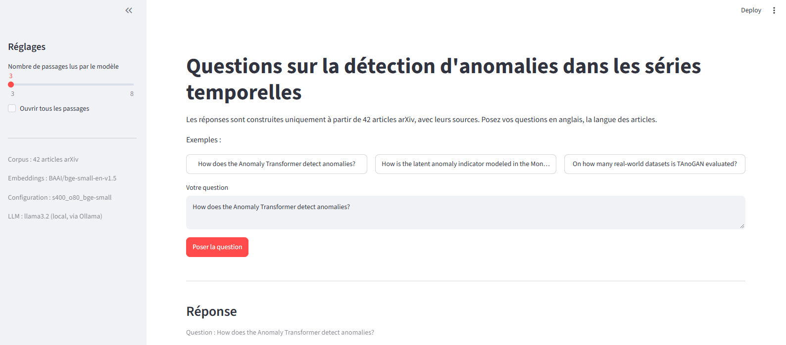
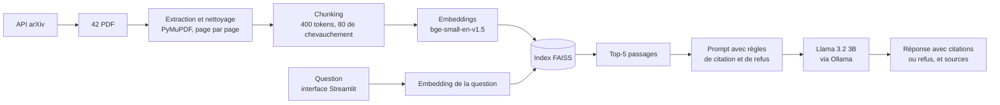

# Assistant RAG sur la littérature en détection d'anomalies

Un assistant de type **RAG** (Retrieval-Augmented Generation) qui répond à des questions techniques sur 42 articles scientifiques arXiv consacrés à la **détection d'anomalies dans les séries temporelles**, en citant ses sources (article et page), et qui refuse de répondre quand l'information n'est pas dans le corpus.



Le cœur du projet est son **évaluation** : 40 questions écrites à l'avance, des mesures automatiques du retrieval, une notation de chaque réponse, et la comparaison de six configurations.

**Résultat principal** : en remplaçant le modèle d'embeddings (MiniLM → bge-small) et en passant à des chunks de 400 tokens, le bon passage est retrouvé dans le top-5 pour **88 % des questions** (contre 64 %), et la part de réponses correctes passe de **43 % à 69 %**, avec 2 hallucinations au lieu de 5.

Tout tourne **en local** : un LLM de 3 milliards de paramètres (Llama 3.2 via Ollama) sur CPU, sans GPU ni API payante. L'assistant s'utilise depuis une **interface web Streamlit**, lançable directement ou dans un **conteneur Docker**.

---

## Sommaire

1. [Architecture](#architecture)
2. [Résultats](#résultats)
3. [Démarche](#démarche)
4. [Évaluation](#évaluation)
5. [Limites](#limites)
6. [Pistes d'amélioration](#pistes-damélioration)
7. [Installation et utilisation](#installation-et-utilisation)
8. [Structure du dépôt](#structure-du-dépôt)
9. [Ce que j'ai appris](#ce-que-jai-appris)

---

## Architecture



**Préparation (une fois)** : téléchargement des articles, extraction du texte, découpage en passages (*chunks*), encodage en vecteurs, indexation.

**À chaque question** : la question est encodée avec le même modèle, FAISS retrouve les 5 passages les plus proches, puis le LLM rédige une réponse **uniquement à partir de ces passages**, en citant `[1]`, `[2]`… ou en refusant avec une phrase fixe.

| Composant | Choix |
|---|---|
| Corpus | 42 articles arXiv, environ 1,5 million de caractères |
| Extraction | PyMuPDF |
| Embeddings | `BAAI/bge-small-en-v1.5` (384 dimensions) |
| Index | FAISS `IndexFlatIP` sur vecteurs normalisés (similarité cosinus) |
| LLM | Llama 3.2 3B via Ollama, température 0, contexte de 4096 tokens |
| Interface | Streamlit |
| Déploiement | Docker (l'application dans le conteneur, Ollama sur la machine hôte) |
| Matériel | CPU uniquement, environ 28 s par réponse |

---

## Résultats

### Retrieval : six configurations comparées

Le bon passage est considéré comme retrouvé s'il vient du bon article et contient la réponse (voir [Évaluation](#évaluation)). Mesures sur 33 questions.

| Configuration | Chunks | hit@1 | hit@3 | hit@5 | hit@8 | hit@10 | MRR |
|---|---|---|---|---|---|---|---|
| MiniLM, 128 tokens, chevauchement 32 | 3512 | 21 % | 48 % | 61 % | 67 % | 70 % | 0,36 |
| MiniLM, 200 / 40 (référence) | 2125 | 15 % | 39 % | 64 % | 79 % | 79 % | 0,33 |
| MiniLM, 200 / 80 | 2815 | 9 % | 48 % | 55 % | 73 % | 79 % | 0,30 |
| MiniLM, 250 / 50 | 1698 | 15 % | 52 % | 67 % | 79 % | 79 % | 0,37 |
| bge-small, 200 / 40 | 2125 | 45 % | 76 % | 76 % | 79 % | 85 % | 0,58 |
| **bge-small, 400 / 80 (retenue)** | **1074** | **52 %** | 73 % | **88 %** | **88 %** | **88 %** | **0,65** |

**Ce que montrent ces chiffres :**

- **Le modèle d'embeddings compte bien plus que la taille des chunks.** À configuration identique (200 / 40), passer de MiniLM à bge-small fait monter le hit@1 de 15 % à 45 % et le MRR de 0,33 à 0,58 : 10 questions de plus ont leur bon passage en première position.
- **Des chunks plus longs regroupent le contexte.** À quantité de texte égale (5 passages de 400 tokens contre 10 de 200), le taux de bons passages est proche (88 % contre 85 %). L'avantage des chunks de 400 tokens est ailleurs : une question dont la phrase clé était coupée entre deux chunks est maintenant retrouvée, et toutes les questions multi-passages ont leur réponse dans le top-3.
- **Augmenter le chevauchement n'a pas aidé** (hit@5 de 55 % contre 64 %). Hypothèse non vérifiée : avec 40 % de texte partagé entre chunks voisins, le top-5 contient des passages quasi identiques qui prennent la place d'autres passages utiles.

### Génération : référence contre configuration retenue

Les deux runs utilisent le même LLM, le même prompt (v2) et 5 passages. Notation sur les 35 questions qui ont une réponse dans le corpus, plus les 5 questions sans réponse.

| | Référence (MiniLM, 200 / 40) | Retenue (bge-small, 400 / 80) |
|---|---|---|
| Réponses correctes | 15 / 35 (43 %) | **24 / 35 (69 %)** |
| Réponses partielles | 9 | 6 |
| Réponses fausses | 11 | **5** |
| Hallucinations | 5 | **2** |
| Refus corrects (questions sans réponse) | 5 / 5 | 5 / 5 |
| Refus à tort | 3 / 35 | **1 / 35** |
| Citations correctes | 21 / 33 | 22 / 34 |
| Temps moyen par réponse | 26 s | 28 s |

Par type de question (configuration retenue) : 17 / 20 correctes pour les questions précises, 4 / 8 pour les questions chiffrées, 3 / 5 pour les questions multi-passages, 0 / 2 pour les questions larges (2 partielles).

**L'essentiel du gain vient du retrieval** : sur les 9 réponses qui deviennent correctes, presque toutes s'expliquent par le fait que le bon passage est maintenant donné au LLM.

### Les échecs restants

| Question | Cause | Piste |
|---|---|---|
| Algorithme utilisé dans l'E-step (q03), nombre de points en entrée (q24) | Le détail est dans un chunk voisin, jamais retrouvé | Ajouter les chunks voisins |
| Méthode « encode-then-decompose » (q12) | Le mauvais article est retrouvé | Recherche hybride avec BM25 |
| Taille du dataset Yahoo (q22) | Le modèle attribue au mauvais article un chiffre lu dans un autre papier | Limite du LLM |
| Écart de MAE (q23) | La bonne phrase est en rang 1, mais le modèle recalcule à partir d'un tableau et se trompe | Limite du LLM sur les chiffres |

q23 échoue de la même façon dans les deux configurations : **un meilleur retrieval ne suffit pas** quand le modèle ignore l'information qu'il a sous les yeux.

---

## Démarche

### 1. Construction du corpus

Les articles sont téléchargés avec l'API arXiv, à partir de sept requêtes (« time series anomaly detection », « multivariate time series anomaly detection », « transformer anomaly detection time series »…). La recherche d'arXiv est une recherche par mots-clés et renvoie beaucoup d'articles hors sujet (vidéo, 3D, graphes, physique). Un filtre ne garde un article que si son **titre ou son résumé** parle à la fois de séries temporelles et d'anomalies. 45 articles ont été retenus, puis 3 retirés à la main après lecture des titres (imagerie satellite, trajectoires de véhicules, finance) : **42 articles**.

### 2. Extraction et nettoyage

Le texte est extrait **page par page** avec PyMuPDF, pour pouvoir citer la page dans les réponses. Nettoyage :

- normalisation Unicode (NFKC), pour remplacer les ligatures (« fi » devient « fi ») qui perturbent la recherche,
- coupe de la bibliographie à partir du dernier titre « References » ou « Bibliography »,
- suppression des lignes répétées sur au moins 30 % des pages (en-têtes et pieds de page) et des numéros de page,
- recollage des mots coupés en fin de ligne,
- suppression des pages devenues vides.

### 3. Chunking

Chaque article est découpé avec une **fenêtre glissante** sur les tokens, en utilisant le tokenizer du modèle d'embeddings, pour que la taille d'un chunk soit exactement celle que lit le modèle. Le chevauchement évite qu'une phrase importante soit coupée net entre deux passages. Chaque chunk garde son article, sa page de début et sa page de fin.

Deux contraintes ont guidé les choix :

- **MiniLM ne lit que 256 tokens** : au-delà, le texte est ignoré sans erreur. Les chunks MiniLM ont donc au plus 250 tokens. bge-small en lit 512, d'où le test à 400 tokens.
- **Les tableaux et figures sortent du PDF comme des suites de nombres.** Un filtre écarte les chunks dont plus de 15 % des caractères sont des chiffres. Le seuil a été choisi en mesurant combien de chunks chaque seuil écarte, puis en relisant les chunks proches du seuil : environ 10 % des chunks sont écartés (239 sur 2364 avec la configuration de référence).

### 4. Recherche

Les chunks sont encodés une fois, les vecteurs sont normalisés et rangés dans un index FAISS `IndexFlatIP` : avec des vecteurs normalisés, le produit scalaire est la similarité cosinus. Pour bge-small, les questions (et pas les passages) reçoivent le préfixe recommandé par le modèle pour la recherche.

### 5. Génération

Le LLM reçoit les 5 passages numérotés, avec leur titre et leurs pages, et ces règles :

- répondre **uniquement** à partir des passages,
- terminer chaque phrase par la citation du passage qui la soutient,
- n'attribuer un fait qu'au papier dont le passage l'énonce, sans généraliser à d'autres papiers,
- signaler qu'une liste est incomplète quand les passages ne couvrent que quelques papiers,
- refuser avec une phrase fixe (« I cannot find the answer in the provided documents. ») quand les passages ne suffisent pas.

La phrase de refus fixe permet de détecter les refus automatiquement. La température 0 rend les réponses reproductibles, ce qui est indispensable pour comparer des configurations.

**Prompt v1 contre v2.** Sur 4 questions de test, la v1 oubliait des citations et attribuait à plusieurs papiers une liste de datasets venant d'un seul. La v2 (règles de citation et d'attribution plus strictes) a corrigé l'attribution et ajouté les citations, sans suivre entièrement la consigne de signaler une liste incomplète. Un petit modèle suit mieux une règle mécanique (« cite chaque phrase ») qu'une règle qui demande un jugement (« décide si ta liste est complète »).

### 6. Interface et déploiement

L'interface Streamlit affiche la réponse, signale les refus, et montre sous la réponse les passages sources avec leur article, leurs pages, leur score de similarité et un lien vers arXiv. Les passages cités dans la réponse sont ouverts et mis en avant, pour vérifier une affirmation en un clic. Le modèle d'embeddings et l'index sont chargés une seule fois au démarrage, puis gardés en mémoire.

Pour le déploiement, l'application est placée dans une image Docker (PyTorch en version CPU, modèle d'embeddings téléchargé pendant la construction, seulement les fichiers de la configuration retenue). Le LLM reste sur la machine hôte, et le conteneur s'y connecte via une adresse configurable par variable d'environnement.

---

## Évaluation

### Le jeu de 40 questions

| Type | Nombre | Exemple |
|---|---|---|
| Précises (un article, une idée) | 20 | « How is the latent anomaly indicator modeled in the Monte Carlo EM paper? » |
| Fait chiffré dans le texte | 8 | « On how many real-world datasets is TAnoGAN evaluated? » |
| Multi-passages | 5 | « What key observation motivates the Anomaly Transformer and how does Anomaly-Attention put it into practice? » |
| Larges (tout le corpus) | 2 | « Which benchmark datasets are commonly used…? » |
| Sans réponse dans le corpus | 5 | « How does the Mamba architecture perform for anomaly detection? » |

Chaque question a une réponse de référence, l'article et la page où se trouve la réponse, et des mots-clés qui identifient les passages contenant la réponse. Les questions sans réponse portent sur des sujets du domaine mais absents du corpus (vérifié par recherche dans tous les chunks), pour tester le refus dans des conditions réalistes. Les questions sont en anglais, comme le corpus.

### Mesures automatiques (retrieval)

- **hit@k** : part des questions dont un bon passage est dans les k premiers résultats.
- **MRR** : moyenne de 1 / rang du premier bon passage (1 en tête, 0,5 en deuxième position, 0 s'il est absent du top-10).

Ces mesures portent sur les 33 questions qui ont un article de référence (les questions larges et sans réponse en sont exclues).

**Le critère de « bon passage » a évolué**, et c'est une partie importante du travail :

| Critère | hit@5 (configuration de référence) | Problème |
|---|---|---|
| Bon article et page de référence | 73 % | **Trop indulgent** : compte comme réussi un chunk de la bonne page qui ne contient pas la réponse |
| Bon article et mot-clé exact de la réponse | 48 % | **Trop strict** : rate un passage qui donne la même information avec d'autres mots |
| Bon article et un mot-clé parmi toutes les formulations de la réponse dans l'article | **64 %** | Critère retenu |

Les mots-clés de la troisième version ont été choisis à partir du **contenu de chaque article** (tous les passages qui contiennent la réponse), pas à partir de ce que le système avait retrouvé, pour ne pas biaiser la mesure. Les deux premiers critères sont conservés dans les résultats pour comparaison.

### Mesures de génération

Contrôles automatiques : détection des refus (phrase fixe ou formulation de refus dans une réponse courte), présence de citations, numéros de citation invalides, citation qui pointe vers un bon passage.

Notation de chaque réponse à partir des **passages réellement fournis au LLM** :

- **C** : l'information attendue, sans erreur,
- **P** : information incomplète, trop générale, ou correcte mais différente de la référence,
- **F** : information fausse, absente, ou refus à tort,
- **Hallucination** : affirmation absente des passages, ou attribuée au mauvais passage ou au mauvais article,
- **Citation correcte** : le passage cité contient l'information.

La notation a été **pré-remplie avec l'aide d'un modèle de langage, puis relue**. Les notes et un commentaire par question sont dans `eval/`.

### Biais connus de l'évaluation

- **Les questions ont été écrites à partir du texte du corpus**, donc chaque réponse existe dans un passage récupérable. Les résultats sont probablement **optimistes** par rapport à de vraies questions d'utilisateurs.
- **33 questions, c'est peu** : une question vaut 3 points de pourcentage. Un écart de moins de 6 à 9 points entre deux configurations n'est pas significatif. Les gains de bge-small (10 à 12 questions de plus en hit@1 et hit@3) dépassent largement ce seuil.
- **Le corpus est couvert de façon inégale** : 8 questions portent sur le même article, et 19 articles n'ont aucune question.
- **Quatre questions ont été modifiées après le premier run**. Une question ambiguë a été reformulée (l'article donne deux jeux de chiffres pour deux expériences), deux réponses de référence ont été complétées avec d'autres formulations valides trouvées dans l'article, et un mot-clé a été ajouté pour une question **après** avoir vu la réponse du modèle (la raison est bien dans l'article, mais ce changement a été influencé par les résultats). L'ancienne version est conservée dans `eval/questions_v1.json`.

---

## Limites

- **Le score de similarité ne détecte pas les questions sans réponse.** Les questions sans réponse ont un score de premier résultat presque aussi élevé que les autres (0,80 contre 0,82 avec bge-small), parce qu'elles portent sur le même domaine. Le refus repose donc entièrement sur le LLM.
- **Les questions larges sont mal couvertes** : la réponse est dispersée dans de nombreux articles, et 5 passages ne suffisent pas. Le modèle a tendance à présenter la liste d'un seul papier comme celle du domaine.
- **Les chiffres sont le point faible d'un petit modèle** : lecture de tableaux, calculs faux, chiffres attribués au mauvais article.
- **Les citations sont moins systématiques avec un contexte plus long** : 11 réponses sans citation avec des chunks de 400 tokens, malgré la consigne.
- **L'extraction des PDF est imparfaite** : tableaux et formules désordonnés, annexes perdues (tout ce qui suit la bibliographie est coupé), notes de bas de page et URL conservées, mots composés coupés en fin de ligne mal recollés.
- **La détection automatique des refus repose sur des formulations** : le modèle reformule parfois son refus (« The paper does not specify… », « I cannot find any information… »), ce que le script peut manquer.
- **Les réponses sont lentes sur CPU** : environ 30 secondes par question, ce qui limite l'usage interactif.

---

## Pistes d'amélioration

Par ordre de priorité, d'après les échecs observés :

1. **Ajouter les chunks voisins** des passages retrouvés, pour les réponses situées juste avant ou après le passage trouvé (q03, q24).
2. **Recherche hybride** (BM25 + embeddings), pour les questions qui nomment une méthode précise (q12).
3. **Reranking** avec un cross-encoder, pour mieux classer le bon passage en tête.
4. **Meilleure extraction des tableaux**, et une consigne explicite pour privilégier les chiffres écrits dans le texte.
5. **Un LLM plus grand ou une API**, et la comparaison de leur fidélité aux sources avec le modèle local.
6. **Un jeu de questions plus large et indépendant du corpus**, et une notation par plusieurs personnes.
7. **Afficher la réponse au fur et à mesure** de sa génération (streaming) dans l'interface, pour réduire l'attente perçue.

---

## Installation et utilisation

### Prérequis

- Python 3.10 ou plus récent
- [Ollama](https://ollama.com) avec le modèle `llama3.2` (environ 2 Go)
- 8 Go de RAM au minimum
- [Docker Desktop](https://www.docker.com/products/docker-desktop/), seulement pour l'option Docker

### Installation

```bash
git clone https://github.com/MohamedN7/rag-anomaly-papers.git
cd rag-anomaly-papers
python -m venv .venv
# Windows
.venv\Scripts\activate
# macOS / Linux
source .venv/bin/activate
pip install -r requirements.txt
ollama pull llama3.2
```

### Reproduire le pipeline

```bash
python src/ingest.py      # télécharge et filtre les articles arXiv
python src/extract.py     # extrait et nettoie le texte, page par page
python src/chunk.py --size 400 --overlap 80 --model bge-small
python src/index.py --size 400 --overlap 80 --model bge-small
```

Le corpus dépend des résultats renvoyés par arXiv au moment du téléchargement : un nouveau téléchargement peut donner un corpus légèrement différent.

### Interface web

```bash
streamlit run app.py
```

Puis ouvrir http://localhost:8501. Ollama doit tourner sur la machine. Un curseur dans la barre latérale permet de choisir le nombre de passages lus par le modèle (de 3 à 8).

### Avec Docker

Ollama doit tourner sur la machine hôte, et l'index de la configuration retenue doit avoir été généré (`chunk.py` et `index.py`), car l'image le copie.

```bash
docker build -t rag-anomaly .
docker run --rm -p 8501:8501 --add-host=host.docker.internal:host-gateway rag-anomaly
```

Puis ouvrir http://localhost:8501. Le conteneur joint Ollama via `host.docker.internal`. Si l'interface indique qu'Ollama ne répond pas, il faut autoriser Ollama à accepter les connexions extérieures (variable d'environnement `OLLAMA_HOST=0.0.0.0`), puis le relancer.

### Poser des questions en ligne de commande

```bash
python src/generate.py    # quatre questions de test
```

### Évaluer

```bash
# retrieval seul (rapide, sans LLM)
python eval/run_eval.py --no-llm --size 400 --overlap 80 --model bge-small

# retrieval et génération (Ollama doit tourner)
python eval/run_eval.py --size 400 --overlap 80 --model bge-small --k-gen 5
```

Chaque configuration écrit ses propres fichiers (`data/chunks_<config>.json`, `data/index_<config>.faiss`, `eval/results_<config>_*.json`), ce qui permet de comparer plusieurs configurations sans rien écraser.

---

## Structure du dépôt

```
rag-anomaly-papers/
├── app.py                   # interface web Streamlit
├── Dockerfile               # image de l'application (PyTorch CPU, bge-small, index)
├── .dockerignore
├── requirements.txt         # environnement de développement
├── requirements-docker.txt  # dépendances de l'image Docker
├── src/
│   ├── ingest.py            # téléchargement et filtrage des articles arXiv
│   ├── extract.py           # extraction et nettoyage du texte (PyMuPDF)
│   ├── chunk.py             # découpage en chunks (taille, chevauchement, modèle en options)
│   ├── index.py             # embeddings et index FAISS
│   ├── retrieve.py          # recherche des passages les plus proches
│   ├── generate.py          # prompt et appel au LLM via Ollama
│   ├── rag_config.py        # configurations (modèles, limites, noms de fichiers)
│   └── find.py              # recherche par mot-clé dans le corpus
├── eval/
│   ├── questions.json       # 40 questions, réponses et mots-clés de référence (v2)
│   ├── questions_v1.json
│   ├── run_eval.py          # évaluation du retrieval et de la génération
│   ├── results_*.json       # résultats par configuration
│   └── notes_*.csv          # notation des réponses
├── data/                    # PDF, textes, chunks et index (régénérables)
├── docs/
│   └── interface.png        # capture de l'interface
└── notes.md                 # journal des expériences
```

---

## Ce que j'ai appris

- **Mesurer avant d'optimiser.** Sans jeu de questions écrit à l'avance, chaque changement aurait été jugé « à l'impression ».
- **Évaluer le retrieval et la génération séparément.** La majorité des mauvaises réponses venaient de passages jamais retrouvés, pas du LLM.
- **Vérifier l'outil de mesure lui-même.** Le premier critère surestimait le retrieval de 9 points, le deuxième le sous-estimait de 16 : il a fallu relire des cas concrets pour s'en rendre compte.
- **Le choix du modèle d'embeddings pèse plus que les réglages de découpage**, du moins sur ce corpus.
- **Un résultat négatif est un résultat** : augmenter le chevauchement n'a pas aidé, et c'est documenté.
- **Un bon retrieval ne garantit pas une bonne réponse** : un petit modèle peut ignorer la bonne phrase ou se tromper sur un chiffre qu'il a sous les yeux.

---

**Auteur** : Mohamed Saadi, élève ingénieur à l'ENSEEIHT (Sciences du Numérique, HPC & Big Data).